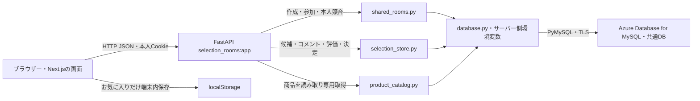
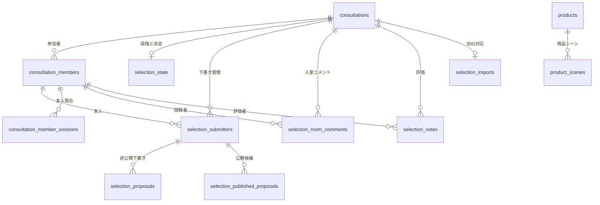

# 接続・データの流れとER図

**11/21の追加合意**：[操作改善・ルーム編集・開設者の初回提案](10_操作改善とルーム編集_開設者の初回提案.md)を反映。主催者は投票前に4項目を編集でき、新規ルームは開設者の1品以上の公開後に参加者が追加する。既存ルームは開いたまま保持。提出は必要な下書きも同送し、最新状態を1回の通信で受け取る。DBは005も適用する。

初心者向け改訂：2026-11-21。知りたいのは「入力がどこへ送られ、どこに残るか」です。画面は入力と表示、APIは依頼の受付と判断、DBは保存を担当します。まず図の矢印を読み、表は後から必要な名前を調べるために使ってください。

## 具体例で考える：星3を押したら

画面は「この商品に星3」という依頼をAPIに送ります。APIはCookieという本人確認用情報から参加者を調べ、「参加済みか」「投票中か」「そのルームの候補か」を確認してDBへ保存します。その後、画面は最新の合計を取得し直します。画面に星が描かれただけで保存成功になるのではありません。

通信のHTTPは依頼と返事の送り方、JSONは商品名や星数を渡すデータの書き方、PyMySQLはPythonからMySQLへ依頼する部品、TLSは通信を暗号化する仕組みです。

マージ後の構成。`GIFTIA_ROOM_STORAGE=shared` と `GIFTIA_CATALOG_SOURCE=shared` を指定する前提です。

## 接続構成

DBに直接接続するのはAPIだけです。フロントは `NEXT_PUBLIC_API_URL` でAPIを指定し、DB資格情報は持ちません。実際の接続値は載せていません。

現在のローカル確認用アドレスは画面 `http://127.0.0.1:3300`、API `http://127.0.0.1:8102`。これは各PC自身のアドレスです。共通DBに保存できても、他の人が自分のPCのlocalhostへアクセスできるわけではありません。

## 操作から保存まで

「下書き」は本人が編集中の記録、「公開候補」は全員へ提出した記録です。phaseはルームの進行段階、versionは下書きの版番号です。版番号が古い保存を拒否することで、別タブからの上書きを防ぎます。upsertは「記録があれば更新、なければ追加」という保存方法です。

```mermaid
flowchart LR
  create["ルーム作成・主催者登録"] --> join["招待先で名前参加"]
  join --> entry["入室時の3分類コメント・任意"]
  entry --> draft["本人だけの下書きを保存"]
  draft --> publish["匿名で提出・異なる商品10品以内"]
  publish --> adjust["主催者がコメント確認・候補調整"]
  adjust --> start["主催者が投票開始"]
  start --> vote["全員が各候補に星1から3"]
  vote --> decide["主催者が単品またはカタログ・決定理由を選択"]
  decide --> save["デモ確認後に決定JSONを保存"]
  save --> history["参加者が決定商品と理由を再閲覧"]
```

| 操作 | 主な保存先と処理 |
|---|---|
| 作成 | `consultations` と主催者の `consultation_members` を同じトランザクションで保存。`selection_state` とセッションを作成 |
| 参加 | `consultation_members` に名前を登録。Cookieのランダム値はブラウザーへ、SHA-256ハッシュと有効期限はDBへ |
| 入室コメント | `selection_room_comments` のkind・textへ。表示上は投稿者名を出さない |
| 下書き保存 | `selection_proposals` と `selection_submitters.version` を更新。古いversionは409で拒否。公開済み内容をここでは変更しない |
| 提出 | 商品の存在・在庫を再確認し、異なる商品ID数を検査。`selection_published_proposals` に公開用コピーを保存 |
| 主催者調整 | 公開候補を追加・差し替え・除外。`curated=1` を使い、主催者の通常再提出で調整候補が消えないよう保持。元の下書きは残す |
| 投票開始 | 主催者・collecting・候補1〜10品を確認し、`selection_state.phase` をvotingへ |
| 投票 | `selection_votes` のルーム×本人×商品でupsert。再評価しても票数が増えない |
| 集計取得 | 商品別の合計星数・評価人数・自分の評価を取得。合計星数の降順、同点は商品ID順。満場一致を表す値ではない |
| 決定 | 主催者・voting・候補に含まれるか・最新の在庫と価格を確認。`selection_state.decision` に商品控えと理由を保存しdecidedへ |

MySQLではルームの親行を `SELECT ... FOR UPDATE` でロックし、候補上限や段階の確認と更新を同じトランザクションで行います。商品確認は別の読取接続です。販売在庫を予約する処理ではありません。

## ER図（主要表）

ER図は、保存用の表どうしの関係図です。表の1行が1つの記録、IDが記録を区別する目印です。`||`は1つ、`o{`は0個以上なので、「ルーム1つに参加者が0人以上ひも付く」と読みます。実際の作成処理では主催者も同時登録します。図はDB上で表現できる関係であり、画面操作の時間順ではありません。

時間順を追う図は[実画面から読むシーケンス図](09_実画面とシーケンス図.md)を参照してください。PK（主キー）はその表の記録を区別する値、FK（外部キー）は他の表への参照関係をDBに守らせる指定です。

[編集可能なFigJam ER図](https://www.figma.com/board/cC7dJoFZmEweqYVAYn6Kh8)。主要列付きの原稿は [図/er.mmd](図/er.mmd)。省略したFKや旧表は以下とSQLを参照。

**重要：候補・評価の `product_id` からproductsへのDB外部キーは追加していません。** 商品の存在はAPIで確認し、候補・決定には商品情報のJSON控えを残します。図のproductsと候補表をFKで結んでいないのはそのためです。`consultations.organizer_id` は参加者IDを保持しますが、`db/schema.sql` にこの列のFK定義はありません。実DBの全表を今回再取得した図ではなく、コードとDDLから整理した主要関係です。

## テーブル一覧

| 表 | 役割・主キー／注意 |
|---|---|
| `products` | 既存商品。`product_id`。読み取りのみ |
| `product_scenes` | 既存商品シーン。`product_id` と `scene_tag` をおまかせ抽出で利用。全列・全キーの今回再確認はしていない |
| `consultations` | 既存ルーム。id、総予算、予定人数、受取期限、主催者ID |
| `consultation_members` | 既存参加者。id、consultation_id、nickname。同一ルームの名前は一意 |
| `consultation_member_sessions` | 002追加。token_hashがPK、room_id・member_id・expires_at。旧移行用legacy_room_id |
| `selection_state` | 002追加。room_idがPK。phase・decision JSON・005追加のorganizer_submitted |
| `selection_submitters` | 002追加。room_id＋member_idがPK。submitted・version。現在は全参加者に使用 |
| `selection_proposals` | 002追加。room_id＋member_id＋product_idがPK。reason・gift JSON |
| `selection_published_proposals` | 003追加。同上の複合PK。公開用reason・gift、004追加のcurated |
| `selection_room_comments` | 003追加。idがPK。room_id・member_id・text、004追加のkind |
| `selection_votes` | 002追加。room_id＋member_id＋product_idがPK。stars 1〜3 |
| `selection_notes` | 002追加。旧共有情報の保持。id・room_id・member_id・kind・text |
| `selection_comments` | 002追加。旧商品別コメントの保持。id・room_id・member_id・product_id・text。新規UIの保存先ではない |
| `selection_imports` | 002追加。source_key＋old_room_idがPK。new_room_idは一意、member_map JSONで参加者ID対応を保存 |

追加分は002の8表＋003の2表＝10表。004は既存の追加表に2列、005は初回提出状態の1列を足します。既存のルーム・参加者・商品を削除して作り直す構成ではありません。

## 決定データと匿名性

「匿名」と「誰か区別しない」は違います。APIが本人を区別できなければ、主催者だけの決定や1人1商品の評価を守れません。内部の識別を保ちながら、共有表示に名前を出さない構成です。

決定JSONは `mode`（single/catalog）、`products`（Giftの配列）、`payment`（demo）、`reasonSources`（votes/comments/otherの配列）、`otherReason` を保存。後日の理由別集計は可能な構造ですが、集計画面・定期集計は未実装です。

匿名とは共有画面に提案者・評価者・コメント投稿者を出さないことです。DBにはmember_idが残り、主催者には参加者一覧が返ります。管理者にも識別不能な完全匿名ではありません。自由文から投稿者を推測される可能性も残ります。

SQLiteの旧データはバックアップ後、新しいMySQL IDへコピーします。`selection_imports` で二重移行を防ぎます。旧Cookieの引継ぎは明示的な操作／`?legacy=1` で行い、通常の招待URLを勝手に旧ルームへ転送しません。同期機能ではありません。
