# 利用フロー・画面遷移と担当ファイル

**11/21の追加合意**：[操作改善・ルーム編集・開設者の初回提案](10_操作改善とルーム編集_開設者の初回提案.md)を反映。主催者は投票前に4項目を編集でき、新規ルームは開設者の1品以上の公開後に参加者が追加する。既存ルームは開いたまま保持。提出は必要な下書きも同送し、最新状態を1回の通信で受け取る。DBは005も適用する。

初心者向け改訂：2026-11-21。この資料は「画面のどこを直したいとき、どのファイルを見るか」を調べる案内です。実際の写真と処理の順番は[09 実画面とシーケンス図](09_実画面とシーケンス図.md)を先に読むと、以下の表を追いやすくなります。

## ファイルを読む前に知る4つの役割

`page.tsx`は画面URLの入口、`SelectionWorkspace.tsx`は共同決定の見た目と操作、`frontend/lib/selection.ts`は画面からAPIへ依頼する係、`backend/selection_rooms.py`は操作してよいか確認して保存する係です。1つのボタンでも、この複数のファイルを通ります。

「関数」は名前を付けた処理のまとまりです。`createRoom()`のような表記を見たら、その処理を実行する意味だと読んでください。以下のGETは取得、POSTは登録や操作の依頼、PUTは更新の依頼です。

以下のパスはリポジトリ直下からの相対パスです。**ルーム作成 → 入室 → 商品候補・諸情報登録 → 投票 → 決定**の順で読めます。

## 画面URLと表示の切替

```mermaid
flowchart LR
  top["検索トップ /・app/page.tsx"] --> newRoom["作成 /rooms/new・new/page.tsx"]
  newRoom --> doorway["ルーム入口 /rooms/ID・ID/page.tsx"]
  doorway --> selection["共同決定 /rooms/ID/select・select/page.tsx"]
  selection --> member["名前参加・未参加時だけ"]
  member --> entry["入室コメント・collecting時"]
  entry --> proposal["提案・検索／お気に入り／おまかせ"]
  proposal --> compare["投票・主催者が開始後"]
  compare --> results["集計・贈り方／決定理由"]
  results --> confirmation["デモ確認・保存"]
  confirmation --> decided["このルームでの決定商品"]
```

`/` → `/rooms/new` → `/rooms/{roomId}` → `/rooms/{roomId}/select` はURLの遷移です。**名前参加以降は原則同じ `/select` の中で表示が変わり、画面ごとに別のpage.tsxがあるわけではありません。** `select/page.tsx` はroomIdを渡す入口で、実体は `SelectionWorkspace.tsx` です。

サーバーが保存する業務段階は `collecting / voting / decided` の3つ。ブラウザーの `tab`（提案・比較・集計）、`entered`（入室済み表示）、`confirming`（購入デモ確認）は画面内状態で、DBのphaseと別です。再読込で画面内状態は初期化されます。

[FigJamで利用フローと担当ファイルを見る](https://www.figma.com/board/cC7dJoFZmEweqYVAYn6Kh8)。編集用原稿は [図/利用フロー.mmd](図/利用フロー.mmd)。

## 1. ルーム作成

利用者がフォームを送信すると、画面の入力を通信用の処理へ渡します。APIは入力を確認し、保存できたときだけ新しいルームのURLを返します。見た目の修正は作成画面、日付等の条件の修正は画面側とAPI側の両方が対象です。

| 役割 | ファイル・処理 |
|---|---|
| 入口 | `frontend/app/page.tsx` の紹介バナー → `/rooms/new` |
| 作成画面 | `frontend/app/rooms/new/page.tsx`：ルーム名・予算・予定人数・受取期限・主催者名、送信中の二重操作防止 |
| 日付UI | `DateCalendar.tsx`：カレンダー。`frontend/lib/rooms.ts`：日付判定、表示、1人あたり負担額の補助 |
| 通信 | `frontend/lib/rooms.ts` の `createRoom()` → `POST /api/rooms` |
| API | `backend/shared_rooms.py` の `create_room()`。入力型は `backend/room_contract.py` の `RoomCreate` |
| 保存 | consultations・consultation_members・selection_state・consultation_member_sessions |
| 次へ | 作成レスポンスの `room_path` を使い `/rooms/{roomId}` へ。主催者Cookieは作成時に発行済み |

## 2. 入室・名前参加・相手の情報登録

主催者は作成時に参加登録済みです。招待された人は最初に名前を登録します。URLは「どのルームか」、Cookieは「このブラウザーの参加者は誰か」を伝えます。401は本人確認ができないという返事で、画面は参加フォームへ切り替えます。

| 役割 | ファイル・処理 |
|---|---|
| 入口画面 | `frontend/app/rooms/[roomId]/page.tsx`：予算・日付・予定人数、URL共有、共同決定へのリンク |
| 共同決定入口 | `select/page.tsx` → `SelectionWorkspace.tsx`。初回に `GET /api/rooms/{id}/selection` |
| 未参加 | 401を `frontend/lib/selection.ts` の `ParticipationRequired` として受け、名前入力を表示 |
| 参加通信 | `frontend/lib/localParticipation.ts` の `joinLocalRoom()` → `POST /api/rooms/{id}/members`。ファイル名はlocalだが、接続先APIがsharedなら共通DBへ保存 |
| 本人照合 | `backend/shared_rooms.py` の `session_member()`・`own_member()`。名前そのものではなくCookieを使う |
| 情報登録 | collectingなら `SelectionWorkspace.tsx` の入室フォームで分類＋本文を入力、またはスキップ |
| コメント通信 | `selection.ts` の `selectionRequest()` → `POST .../selection/comments` → `selection_rooms.py` の `comment()` → selection_room_comments |
| 次へ | `entered=true` にして提案UIを表示。URLは `/select` のまま。投票中に入った人にはコメント入力を出さない |

入室フォームは画面内stateで管理しており、サーバーに「この人は今回入室コメントを済ませた」という専用フラグはありません。候補提出期間の再読込・再訪では再び入力／スキップが表示されます。APIは1人1回に制限していません。

## ルーム情報を修正する

主催者は投票前に`RoomSettingsEditor.tsx`のフォームでルーム名・総予算・予定人数・受取期限を修正します。`selection.ts`→`PUT .../selection/room`→`selection_rooms.edit_room`の順で保存し、再取得します。日付・数値の規則は`room_contract.RoomSettings`で作成と共用します。

## 3. 商品候補・諸情報登録と主催者調整

候補を画面に追加する、下書きをDBへ保存する、全員に提出する、は別の操作です。主催者の「投票候補を追加する」は公開候補を直接調整する操作で、通常の本人下書き編集とは別の経路を使います。

| 機能 | 画面／呼出元 | API・実装 | 保存・表示 |
|---|---|---|---|
| 通常検索 | `SelectionWorkspace.tsx` → `frontend/lib/api.ts` のsearchGifts | `GET /api/search` → selection_rooms.search → product_catalog.SharedProductCatalog.search | productsを読取。通常検索はおまかせの80〜100％・★4条件とは別 |
| お気に入り | `frontend/lib/useFarewellFavorites.ts`・`farewellFavoritesStore.ts` | 選択時点では商品検索API不要。提出時に商品を再確認 | localStorage。空なら会員登録の案内文。登録ページは作らない |
| おまかせ | `SelectionWorkspace.tsx` のカテゴリー・シャッフル | `GET .../selection/categories`・`GET .../selection/random?category=...` → product_catalog／selection_rooms | 共通DBから条件内の最大3品。抽出だけでは提出にならない |
| 下書き | 同ファイルの候補追加・保存 | `PUT .../selection/proposal` → save_proposal | selection_proposalsとversion。本人だけに返す |
| 提出 | 同ファイルの提出ボタン | `POST .../selection/submit` → submit | selection_published_proposalsへコピー、重複商品をまとめて全員表示 |
| 相手の情報を読む | 同ファイルの分類付き一覧 | `GET .../selection` → get_selection | 入室コメント＋旧情報を匿名表示。常設コメント入力欄はない |
| 主催者の追加・差し替え | 同ファイルの候補調整モード | `POST .../selection/curation` → curate | 公開候補を更新。10品時にも差し替え可能。元下書きは維持 |
| 主催者の除外 | 同ファイルの除外ボタン | `POST .../selection/curation/remove` → remove_curated | 公開候補だけを除外 |
| 投票開始 | 主催者の投票開始ボタン | `POST .../selection/start-voting` → start_voting | phase=voting。候補変更を凍結。全員提出待ちなし |

## 4. 投票

`SelectionWorkspace.tsx` の比較表示で各商品に★1〜3を付けます。`selectionRequest()` → `PUT /api/rooms/{id}/selection/products/{productId}/vote` → `selection_rooms.py` の `vote()` → `selection_store.py` の `save_vote()` → selection_votes、という順です。

成功後は `reload()` で共同状態を再取得し、星合計・評価人数・自分の評価を更新します。投票中にコメント入力は表示せず、APIもコメント／共有情報を空配列にして返します。全員投票済みを必須にする仕組みはありません。

## 5. 集計・決定・後日の閲覧

集計タブを開くだけでは決定しません。主催者が贈り方・商品・理由を選び、デモ確認後に保存して初めてDBの段階が決定済みになります。`setTab`や`confirming`は画面内の切替、`decide()`はサーバーへの保存処理です。

| 役割 | ファイル・処理 |
|---|---|
| 集計へ | `SelectionWorkspace.tsx` の `setTab("results")`。URL遷移はない |
| 商品・贈り方 | 同ファイルで単品1つ／カタログ掲載候補を選択。最多票の商品を自動確定しない |
| 決定理由 | 同ファイルでvotes・comments・otherを複数選択。other選択時は自由入力必須 |
| デモ確認 | `confirming=true` で確認UIを表示。外部の決済画面へは移動しない |
| 保存通信 | `POST .../selection/decision` → `backend/selection_rooms.py` の `decide()` |
| 保存先 | selection_state.decision JSONとphase=decided |
| 再閲覧 | 同じ `/rooms/{id}/select` を再訪 → GET selection → 決定商品・理由表示。専用の全ルーム履歴一覧はない |

## 共通ファイル・旧系統・テスト

| ファイル | 役割・触るときの目安 |
|---|---|
| `frontend/app/rooms/RoomShell.tsx`・`rooms.css` | ルーム共通の外枠・スタイル |
| `select/selection.module.css` | 共同決定画面だけのスタイル |
| `frontend/lib/selection.ts` | 最新共同決定の型・認証付きHTTP・旧データ引継ぎ。API項目変更時はここも更新 |
| `backend/selection_rooms.py` | ルーム段階、権限、候補数、入力、公開応答のルールを変える場所 |
| `backend/shared_rooms.py` | 共通DBの参加・本人セッション・親行ロック |
| `backend/selection_store.py` | MySQL/SQLiteのupsert等の差分。画面や業務ルールの置き場ではない |
| `backend/database.py` | DB接続と共通transaction。秘密の値はコードに書かない |
| `backend/manage_shared_storage.py`・`db/migrations/*.sql` | スキーマ適用と旧データ移行。起動するだけではMySQLのDDLは適用されない |
| `backend/main.py`・`rooms.py` | 従来検索・ルーム作成取得API。最新の名前参加・共同決定と入口が異なる |
| `backend/local_rooms.py`・`candidate_demo.py`、`frontend/app/rooms/[roomId]/single/` | 旧ローカル／個人入力の検証。最新selectとデータ構造・制限が異なるため混在させない |
| `frontend/app/rooms/RoomParticipation.tsx` | 旧single向け参加UI。最新selectの入室フォームはこれではない |
| `backend/test_selection_rooms.py` | 最新の段階・上限・匿名性・調整・評価・理由の回帰確認 |
| `backend/test_shared_selection_integration.py` | 明示的に有効化して共通MySQLで同じルールを確認 |
| `backend/test_shared_storage.py`・`test_product_catalog.py` | 移行・DB差分・商品条件の確認 |
| その他`backend/test_*.py`、`frontend/tests/` | 従来API・入力・お気に入り等の回帰確認。全画面のE2E網羅ではない |

画面文言だけを変える場合と違い、権限・上限・条件はフロントだけでなくAPI側の検証と対応テストも合わせて修正します。
