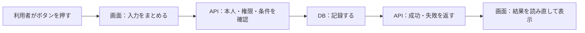

# Giftiaを自分の言葉で説明するための学習版

**11/21の追加合意**：[操作改善・ルーム編集・開設者の初回提案](10_操作改善とルーム編集_開設者の初回提案.md)を反映。主催者は投票前に4項目を編集でき、新規ルームは開設者の1品以上の公開後に参加者が追加する。既存ルームは開いたまま保持。提出は必要な下書きも同送し、最新状態を1回の通信で受け取る。DBは005も適用する。

2026-11-20。今回のPR・追加修正がすべてマージされた後を前提とする説明です。実際にマージ済みという意味ではありません。コードと詳しい対応表は [03 機能とファイル](03_機能とファイル.md) を併読してください。

この資料の目標は、コードを全部暗記することではありません。「このボタンを押したとき、誰が判断し、どこに保存し、何を表示するのか」を実際のファイルを指して説明できることです。

実際の画面を見ながら学ぶ場合は、[写真とシーケンス図のHTML版](画面から学ぶ_Giftia.html)を先に開いてください。作成から決定までの9枚の写真と6本の図を追加しました。図の読み方は[09](09_実画面とシーケンス図.md)にあります。

「なぜ作るか」は要求、「何を作るか」は要件です。[要求・要件との対応](07_要求と要件の整合.md)も合わせて読むと、機能の動きだけでなく、利用者の困りごととのつながりを説明できます。最新合意を正として両方のmd本文を更新しました。

## 1. まず、このアプリは何をするものか

職場の送別品を、主催者ひとりで抱え込まず、参加者の提案や相手についての情報を参考に決めるための試作です。

利用する順番は次のとおりです。

1. 主催者がルームを作る。
2. 参加者がURLを開き、名前で参加する。
3. 相手の好みなどを入室時に伝え、商品候補を提出する。
4. 主催者が候補を調整して投票を開始し、全員が★1〜3で評価する。
5. 主催者が商品またはカタログを選び、理由とともに決定を保存する。

最多票の商品を自動で購入する仕組みではありません。主催者が決めます。支払いと実際の配送はありません。全員の同意や、売上改善を確認できたわけでもありません。

## 2. 「画面」「API」「DB」の3つに分ける

注文窓口にたとえると、画面は記入用紙、APIは用紙を受け付けて確認する担当、DBは記録を保管する台帳です。ただしAPIは記録を渡すだけでなく、「その人に操作する権限があるか」も判断します。

| 言葉 | 意味 | Giftiaでは |
|---|---|---|
| フロントエンド | 利用者が見る画面と、その操作を処理する部分 | `frontend/`。Next.js・Reactで作成 |
| バックエンド | 画面から依頼を受け、ルールを確認し保存する部分 | `backend/`。PythonのFastAPIで作成 |
| API | プログラム同士が依頼と結果をやり取りする窓口 | 「ルームを作って」「投票を保存して」などのURL |
| データベース（DB） | 情報を整理して保存・取得する仕組み | 共通のAzure Database for MySQL |
| テーブル | DBの中で同じ種類の情報を並べる表 | ルーム表、参加者表、投票表など |
| ID | データを区別する番号や文字列 | ルームID、参加者ID、商品ID |



この往復が、ほとんどの機能の共通形です。画面からDBへ直接接続しません。DBのパスワードをブラウザーへ渡さないためにも、確認をAPIに集めるためにも、この分担が必要です。

Next.jsにはサーバーで動く機能もありますが、今回の入力や投票の中心画面はブラウザーで動くコンポーネントです。DB操作の責任はFastAPI側に置いています。

## 3. ファイル・関数・URLは別のもの

「ファイル」はコードを保存する場所、「関数」はその中のひとまとまりの処理、「URL」は画面やAPIにアクセスするための住所です。

たとえば `frontend/lib/rooms.ts` というファイルには `createRoom()` という関数があり、この関数が `/api/rooms` というAPIのURLへ依頼します。ファイル名がそのままAPIのURLになるわけではありません。

| 見かける表記 | 読み方・役割 |
|---|---|
| `.tsx` | TypeScriptで画面の部品を書くファイル。見た目と操作を扱う |
| `.ts` | TypeScriptの処理・データの型など。通信処理にも使う |
| `.py` | Pythonのコード。今回のAPIはこれで書く |
| `.css` | 文字の色、余白、配置などの見た目 |
| `.sql` | DBの表を作る・データを取得する等のSQL命令 |
| `page.tsx` | Next.jsで、そのフォルダに対応する画面URLの入口 |
| `[roomId]` | ルーム番号によって変わる部分。`/rooms/32`ならroomIdは32 |
| `lib/` | 複数の画面から使う通信や補助処理を置く場所 |
| `import` | 別のファイルにある処理や部品を読み込んで使う |
| `async`・`await` | 通信などの完了を待ってから次を処理するための書き方 |
| `fetch` | ブラウザー等からAPIへHTTP通信する処理 |
| JSON | プログラム同士がデータを渡すための表し方。キーと値を組にする |

通信の `GET` は取得、`POST` は作成や操作の依頼、`PUT` は更新に使います。Giftiaでは同じ `/api/rooms` でも、POSTは作成の意味です。

## 4. ルーム作成を、実際のファイルで追う

### 利用者から見える動き

検索トップでルーム作成を選び、名前・予算・人数・期限などを入力し、作成ボタンを押します。作成できたらルームの入口へ移ります。

### 裏で起こること

| 順番 | ファイルと処理 | やさしくいうと |
|---|---|---|
| 1 | `frontend/app/page.tsx` | 作成画面へのリンクを表示する |
| 2 | `frontend/app/rooms/new/page.tsx` | 入力を受け取り、送信処理を始める |
| 3 | `frontend/lib/rooms.ts` の `createRoom()` | 入力をJSONにまとめ、POST `/api/rooms`へ送る |
| 4 | `backend/room_contract.py` の `RoomCreate` | 予算が正の整数か、日付が使えるか等を確認する |
| 5 | `backend/shared_rooms.py` の `create_room()` | ルームと主催者を登録し、本人確認用の情報も用意する |
| 6 | `backend/database.py`・MySQL | 共通DBに記録する |
| 7 | 作成APIの結果を画面が受け取る | 新しいルームのIDと移動先を受け取る |
| 8 | `/rooms/{roomId}` へ移動 | そのルームの予算や期限、共同決定への入口を表示する |

説明用の架空の入力は、たとえば次のようなJSONです。実際の接続情報は含みません。

```json
{
  "title": "送別ギフト相談",
  "budget_total": 6000,
  "member_count": 5,
  "deliver_by": "2026-11-24",
  "nickname": "主催者"
}
```

`member_count`は予定人数で、入室できる上限人数ではありません。受取期限は未来の平日・祝日以外かを確認しますが、その日までの配送を保証する機能ではありません。

**説明できるようにする一文：**「画面で入力したルーム情報をAPIが確認し、ルームと主催者を共通DBへ保存して、発行されたルーム番号の画面へ移ります。」

## 5. 入室すると、どうやって本人が分かるのか

URLを共有しても、同じURLを開いた人が全員同じ参加者になるわけではありません。参加者は名前で登録し、ブラウザーは本人確認用のCookieを受け取ります。

Cookieはブラウザーが保存して、対象のAPIへの通信に添える情報です。今回のCookieは推測しにくいランダムな値です。APIはその値から計算したハッシュをDBの記録と照合して、「このルームの、この参加者」と判断します。ハッシュは元の値をそのまま保存しないための変換です。

| 担当 | ファイル |
|---|---|
| 共同決定画面を開く | `frontend/app/rooms/[roomId]/select/page.tsx` |
| 未参加なら名前フォームを表示 | 同フォルダの `SelectionWorkspace.tsx` |
| 参加依頼を送信 | `frontend/lib/localParticipation.ts` の `joinLocalRoom()` |
| 参加者・セッションを保存しCookieを発行 | `backend/shared_rooms.py` |
| 次の通信でCookieを添付 | `frontend/lib/selection.ts` の `credentials: "include"` |

Cookieの値は画面のJavaScriptから直接読めないHttpOnlyという属性にしています。ただし会員アカウントへのログインではなく、Cookieを削除したときや別端末での本人復元は未実装です。

**匿名との関係：** APIは誰かを区別していますが、提案・投票・コメントの共有表示には名前を出しません。内部でも誰か分からない完全匿名とは違います。主催者は参加者一覧を見ることができます。

## 6. 相手の情報と商品候補は、別々に記録する

入室時に書く「甘いものが好き」「強い香りを避けたい」などは、贈る相手についての情報です。「好み／避けたいもの／その他」の分類を付け、`selection_room_comments` に保存します。情報がなければスキップできます。

一方、商品候補には商品ID・商品情報・提案理由を保存します。相手の情報と商品の提案は用途が異なるため、別の表を使います。コメントを書いただけで、商品を自動的に安全判定したり除外したりはしません。

### 商品を選ぶ3つの方法

| 方法 | 何をするか | 主なファイル |
|---|---|---|
| 検索 | キーワード等をAPIに送り、DBの商品を探す | `frontend/lib/api.ts` → `backend/product_catalog.py` |
| お気に入り | このブラウザーで保存した商品から選ぶ | `frontend/lib/useFarewellFavorites.ts`・`farewellFavoritesStore.ts` |
| おまかせ | 選んだカテゴリーと条件に合う商品をランダムに出す | `backend/selection_rooms.py` の `random_products()` |

総予算6,000円の場合、おまかせは価格4,800〜6,000円、商品レビュー平均★4.0以上、在庫あり、送別タグあり、選んだカテゴリーという条件です。最大3品を表示します。3品表示することと、1人3品までしか提出できないことは違います。現在は全体で最大10品です。

お気に入りの保存先は共通DBではなくlocalStorageです。localStorageはブラウザー内の保存場所なので、別の端末へ自動で引き継がれません。会員登録の案内が出ても、登録機能が完成しているわけではありません。

### 下書きと提出を分ける理由

下書きは「まだ本人が編集中」、提出済み候補は「みんなが見てよい内容」です。これを同じ記録だけで管理すると、編集中にみんなの候補が消えたり変わったりしてしまいます。

| 状態 | 保存先 | 見える範囲 |
|---|---|---|
| 入力中で未保存 | ブラウザーの画面内の変数 | その画面だけ。再読込で失う場合がある |
| 保存した下書き | `selection_proposals` | APIは本人へだけ返す |
| 提出した候補 | `selection_published_proposals` | 参加者へ匿名で公開 |

画面の担当は `SelectionWorkspace.tsx`。下書き保存はAPIの `save_proposal()`、提出は `submit()` です。画面で「追加」しただけなのか、DBへ保存したのか、全員へ提出したのかを区別して説明しましょう。

## 7. 主催者が投票を始めると何が変わるか

APIはルームの段階を `selection_state.phase` に保存しています。

| 保存する値 | 意味 | 主にできること |
|---|---|---|
| `collecting` | 候補提出期間 | 入室情報・候補提出・主催者の追加や差し替え |
| `voting` | 投票中 | 各候補に★1〜3で投票 |
| `decided` | 決定済み | 決定した商品と理由を閲覧 |

主催者が「投票開始」を押すと、`start_voting()` が本人・主催者か・候補が1〜10品あるかを確認し、votingへ変えます。全員の提出を待つ自動開始ではありません。

投票の途中で商品が変わると、何に評価したのか分からなくなるため、開始後の候補変更を止めます。コメントの投稿も止め、投票画面ではコメント一覧も表示しません。

**ボタンを隠すだけでは不十分です。** APIへ直接依頼する方法もあるため、API側でも段階と権限を確認して拒否します。ここが画面とAPIの両方を作る理由のひとつです。

## 8. 投票は、何を保存して何を集計するか

投票を保存する `selection_votes` は、ルームID・参加者ID・商品IDの組を一意にします。「どのルームの誰が、どの商品に何点を付けたか」という記録です。

たとえば、同じ商品にAさんが★3、Bさんが★2なら、合計星数は5、評価人数は2です。Aさんが★1に変更したら、Aさんの記録を更新するので合計は3、評価人数は2のままです。票をもう1つ追加しません。この「存在すれば更新、なければ追加」をupsertと呼びます。

処理は `SelectionWorkspace.tsx` → `selection.ts` → `selection_rooms.py` の `vote()` → `selection_store.py` の `save_vote()` → DB、という順です。

商品レビュー平均★4以上は商品にもともと付いているレビューで、今回の参加者の★1〜3とは別です。また、未評価の人を賛成と数えません。評価人数を見ても全員が同意したとは断言できません。

## 9. 決定した内容は、後でどう見られるか

主催者が集計画面で贈り方・商品・理由を選び、デモの確認を経て保存します。単品なら1品、カタログなら受取人が1品選ぶための候補を保存します。

決定理由は「投票結果を参考にした」「コメントを参考にした」「その他」を複数選択できます。保存するときには表示文ではなく `votes / comments / other` という固定のコードを使います。後から理由別の件数を数えるとき、表記の揺れを防ぐためです。その他は自由入力も必要です。

`selection_rooms.py` の `decide()` が、候補に含まれるか、最新の在庫があるか、各商品が総予算以内かを確認し、商品情報と理由を `selection_state.decision` にJSONで保存します。その後phaseをdecidedへ変えます。

決定した商品の名前や価格は、その時点の情報の控えも保存します。商品IDしか残さないと、後に商品名や価格が変わったときに「何を選んだか」が分かりにくいためです。ただしこれは注文書でも在庫予約でもありません。

参加者は同じルームURLを開けば決定商品と理由を見られます。過去のすべてのルームを並べる履歴一覧や、受取人が実際にカタログから選んで注文する機能は、まだありません。

## 10. 「画面が変わる」と「別のURLへ移る」は違う

作成から入口まではURLが変わります。しかし共同決定では、ひとつの `SelectionWorkspace.tsx` の中で表示を切り替えています。

| 種類 | 例 | 保存される場所 |
|---|---|---|
| URL | `/rooms/32/select` | ブラウザーのアドレス欄。32は説明用のルーム番号 |
| 画面だけの状態 | 提案／比較／集計のタブ、デモ確認中か、入室フォームを通過したか | Reactのstateという画面内の変数 |
| 全員が共有する段階 | collecting／voting／decided | DBのselection_state |

`useState` は画面内の値を覚えて表示に反映するReactの仕組みです。DB保存とは違い、再読込で初期化されます。`useEffect` は画面を開いたときなどに取得処理を始めるために使っています。

そのため、候補提出期間に再訪すると入室コメントの入力／スキップが再び表示されます。一方、投票開始や保存済みの決定はDBから取得して復元できます。

## 11. DBの表を分け、IDで結ぶ意味

すべてを巨大な1つの表に入れるのではなく、役割ごとに分けます。ルームの情報を投票のたびに書き直さずに済み、個別の情報を更新しやすくなります。

| 表 | ひとことでいうと | 他の表とのつながり |
|---|---|---|
| consultations | どんな集まりか | ルームのidを各記録で使う |
| consultation_members | 誰が参加したか | consultation_idでルームにつながる |
| selection_proposals | 本人の下書き | room_idとmember_idで所属・本人につながる |
| selection_published_proposals | みんなへ提出した商品 | 同じくルームと本人にひも付くが、名前は共有表示に出さない |
| selection_room_comments | 相手についての情報 | room_idとmember_idを保持 |
| selection_votes | 商品への評価 | room_id・member_id・product_idで評価を区別 |
| selection_state | 現在の段階・決定内容 | ルームごとに管理 |

主キー（PK）は表の中で記録を一意に区別する値、外部キー（FK）は別の表の記録との関係をDBに守らせる指定です。ER図は、その表どうしのつながりを見えるようにした図です。

なお、今回の候補の商品IDにはproductsへのDB外部キーを付けていません。APIで商品の存在を確認しています。「IDを記録する」ことと「DBに外部キー制約を作る」ことは別です。詳しい図と例外は [02 接続とデータの流れ](02_接続とデータの流れ.md) を参照してください。

## 12. 同時操作や保存失敗に備える仕組み

初心者が説明するときは、まず「何を防ぐか」を言い、次に名前を添えると伝わります。

| 防ぐ問題 | 使う仕組み | 今回の例 |
|---|---|---|
| 途中だけ保存され、ルームと主催者が食い違う | トランザクション。まとめて成功か、失敗時は取り消し（rollback） | ルーム作成と主催者登録 |
| 残り1枠に2人が同時提出し、11品になる | 親ルーム行のロック。同じルームの判断と更新を順番に処理 | MySQLのSELECT FOR UPDATE |
| 古いタブが新しい下書きを上書きする | version。保存時の版番号が合うか確認 | 古ければ409で保存を拒否 |
| 同じ人が評価し直すたびに票数が増える | 一意なキーとupsert | 本人・ルーム・商品につき1評価 |
| 入力がSQL命令として解釈される | SQLの値をパラメーターとして渡す | `%s`と値を分けて実行 |

HTTPの401は未参加など本人確認ができない場合、403は権限がない場合、409は段階や版の競合、422は入力形式が不正、503はDB等を使えない場合に使います。実際の意味は各APIの処理も確認します。

これらは「すべての障害を防げる」という意味ではありません。DB接続数・バックアップ・監視・公開環境でのセキュリティ等は別に必要です。

## 13. 共通DB・環境変数・デプロイの関係

環境変数は、コードとは別に渡す設定です。「どのAPIへ接続するか」「どのDBを使うか」を、コードにパスワードを書かずに切り替えられます。`.env` はその設定をアプリへ渡すためのファイルのひとつです。この資料では内容を読みません。

| 設定・言葉 | 説明 |
|---|---|
| `NEXT_PUBLIC_API_URL` | 画面が依頼を送るAPIの住所。ブラウザーに配られるため秘密を置かない |
| `GIFTIA_ROOM_STORAGE=shared` | ルームや評価を共通MySQLへ保存する指定 |
| `GIFTIA_CATALOG_SOURCE=shared` | 商品を共通DBから取得する指定。保存先とは別の設定 |
| `selection_rooms:app` | Pythonのselection_rooms.pyにあるappを起動する指定 |
| localhost／127.0.0.1 | そのアドレスを使っているPC自身。共同開発者のPCを指す住所ではない |
| デプロイ | アプリを利用先のサーバーへ配置し、そこで動かすこと |
| マイグレーション | アプリの変更に合わせ、DBに必要な表や列を追加・変更する作業 |

同じDBを使えば、各APIは同じ保存データを扱えます。それでも、画面とAPIを他の人から使える住所で公開することは別作業です。公開する場合はHTTPS・Cookie・CORSの設定も必要です。CORSは、ブラウザーで別の住所のAPIと通信するときの許可に関する仕組みで、本人認証の代わりにはなりません。

コードのPRをマージしても、DBに表は自動追加されません。今回の002・003・004の追加SQLは管理スクリプトで適用します。既存DBには以前の作業で適用済みですが、新しい環境では準備が必要です。実際の起動手順は [04 条件と起動](04_条件と起動.md) を使ってください。

Gitはコードの変更履歴を管理する道具です。ブランチは変更作業を分ける場所、コミットは変更の記録、PRはその変更をレビューする依頼、マージは変更を取り込むことです。マージとデプロイとDB適用は、それぞれ別の操作です。

## 14. コードを読む順番と、安全な観察

最初から全ファイルを読むより、1つの操作を追ってください。次の順番がおすすめです。DBへの直接書込や、既存ルームの変更は学習に不要です。

1. `frontend/app/rooms/new/page.tsx`で作成フォームと送信処理を探す。
2. `frontend/lib/rooms.ts`で`createRoom()`、`fetch`、`POST`、`JSON.stringify`を探す。
3. `backend/shared_rooms.py`で`create_room()`を探し、保存する表を確認する。
4. `backend/room_contract.py`で入力条件を確認する。
5. `select/page.tsx`を読み、`SelectionWorkspace`にroomIdを渡すだけの入口であることを確認する。
6. `SelectionWorkspace.tsx`で`selectionRequest`を探し、ボタンからAPIへのつながりを追う。
7. `frontend/lib/selection.ts`で通信先の組立てとCookie付き通信を見る。
8. `backend/selection_rooms.py`で`save_proposal`→`submit`→`start_voting`→`vote`→`decide`を順に読む。
9. `db/migrations/`と [02の表一覧](02_接続とデータの流れ.md)を照らし、保存先を確かめる。
10. `backend/test_selection_rooms.py`で、成功だけでなく拒否される条件も読む。

手元のダミールームで観察する場合は、ブラウザーの開発者ツールのNetworkを開き、ボタンを押す前後でAPIのURL・メソッド・成功／失敗のステータスを見るとつながりが分かります。Cookie・認証情報・実際の個人コメントを共有用スクリーンショットに含めないでください。今回この資料の作成のために新しいルームや投票は作っていません。

コードに説明のない部分を見つけたら、AIには「この関数の入力・処理・出力・保存先を、実際のコードに沿って説明して。コードは変更しないで」と依頼すると、理解と実装変更を分けられます。説明を受けたら、自分で該当箇所を開いて確かめてください。

## 15. 発表で使う説明例

次は構成を説明する例です。「自分が全コードを書いた」「顧客効果を実証した」といった未実施のことは含めていません。

> Giftiaの既存検索に、送別ギフトを参加者で決める機能を追加しました。画面はNext.js、操作の確認と保存はFastAPI、共有データはMySQLが担当します。参加者は名前で入室し、相手の好みなどを伝え、匿名で候補を提出します。公開候補は全体10品までで、主催者が調整してから投票を開始します。参加者は各商品を星1から3で評価し、主催者は商品と決定理由を保存します。内部ではCookieで本人を区別し、画面には評価者やコメント投稿者の名前を出しません。支払いはデモで、全員の同意確認や実際の注文・配送はまだありません。

「なぜそうしたか」を聞かれたら、10品上限は選びやすさを保つための合意、下書きと公開の分離は編集中の内容を全員に反映させないため、決定理由の保存は後から根拠を共有・集計できるようにするため、と説明します。効果は今後の検証対象です。

## 16. 理解の確認問題

先に答えを見ず、各問いに2〜3文で答えてからコードを指して説明してみてください。

1. ボタンを押してからDBへ保存されるまで、どんな順に処理されますか？
2. なぜ画面だけで「主催者か」「最大10品か」を確認してはいけませんか？
3. 候補を下書き保存することと提出することは、何が違いますか？
4. 同じURLを使う参加者を、APIはどう区別しますか？匿名と矛盾しませんか？
5. ★4以上という条件と、★1〜3の投票は何が違いますか？
6. お気に入りと投票は同じ場所に保存されますか？
7. 画面を再読込すると何が消え、何がDBから戻りますか？
8. 同時提出で11品になることを、どう防ぎますか？
9. PRをマージすれば、全員がすぐ使えてDBの表も増えますか？
10. このアプリで実現できたことと、実運用でまだ必要なことは何ですか？

### 答え合わせの要点

1. 画面→通信用関数→APIで条件確認→DB保存→結果を返す→画面を更新。作成の例は第4章。
2. 画面を通さずAPIを呼ぶこともでき、別画面・他の人による変更もある。APIが最後に確認する。
3. 下書きは本人用の保存、提出は公開用表へ反映。編集中でも以前の公開候補を維持する。
4. CookieとDBのセッションで区別する。匿名は共有表示に名前を出さない意味。
5. 商品にもともとあるレビューと、このルームの参加者評価は別のデータ。
6. お気に入りはブラウザー内、投票は共通DB。
7. 未保存入力・タブ等の画面内stateは初期化。保存済み下書き・公開候補・段階・投票・決定は取得できる。再入室コメント画面が出る場合がある。
8. 親ルーム行をロックし、上限確認と追加を同じトランザクションで行う。
9. マージはコードの統合。起動・公開先設定・必要なDB適用は別。
10. 共同での提案・評価・理由付き決定保存はできる。実決済・配送・本人復元・全員の合意確認・公開環境整備等は残る。

分からなかった問題だけ、対応する章と実ファイルへ戻りましょう。最終的には「どう動くか」「なぜ分けたか」「まだ何ができないか」の3つを説明できれば、実装を理解して説明する土台になります。
