# 実際の画面から読むシーケンス図

確認日：2026-11-21。学習用の架空ルーム34で、作成→入室コメント→飲料おまかせ→2品提出→投票→単品決定→再読込を操作した画面と、担当コードを照合した説明。実利用者の情報や実決済は使っていない。

**[画面写真と図をまとめたHTML版を開く](画面から学ぶ_Giftia.html)**。外部通信・追加ライブラリなしで写真と図を表示する。

**11/21追補：写真は当時のルーム34、図は最新の通信削減を反映。編集・開設者先行・計測値は[10の追補](10_操作改善とルーム編集_開設者の初回提案.md)を参照。**

## 図の読み方

横に並ぶ箱は担当、縦の線はその担当の時間の流れ。上から下に読み、矢印は処理の依頼や結果を渡す方向。同じ列へ戻る矢印は、その担当の中だけで行う処理。番号は読む順番であり、ソースの行番号ではない。

写真は見える事実、矢印の中のファイル名・関数・保存先はコードから確認した内部処理。通信パケットの実測ログではなく、理解のため必要な処理を抜き出した図で、各SQLや毎回の本人照合等をすべて描いてはいない。

画面での名称は「幹事」と「主催者」が混在するが、同じ作成者の権限を指す。主催者自身も投票できるので、今回の撮影は1人のブラウザーで行った。別参加者との同時操作の検証ではない。

## 1. ルームを作る

画面URL：`/rooms/new → /rooms/34`。操作：「この内容でルームを作る」を押す。

名前・予算・人数・日付を入力する画面です。右側の負担額プレビューは画面内の計算で、この表示だけではDBに保存されません。作成ボタンを押し、APIが保存に成功した後でルーム入口へ移ります。

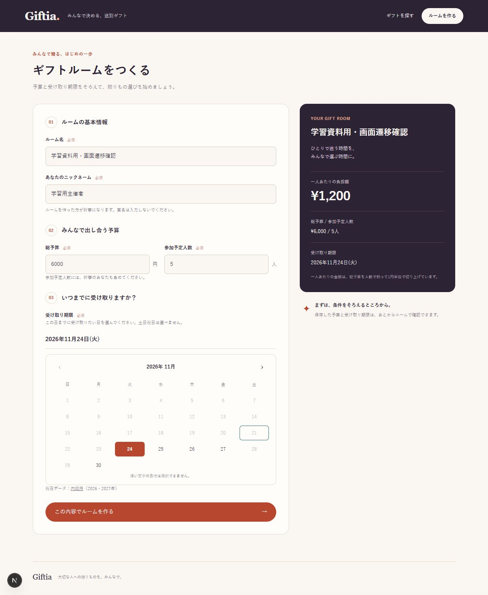

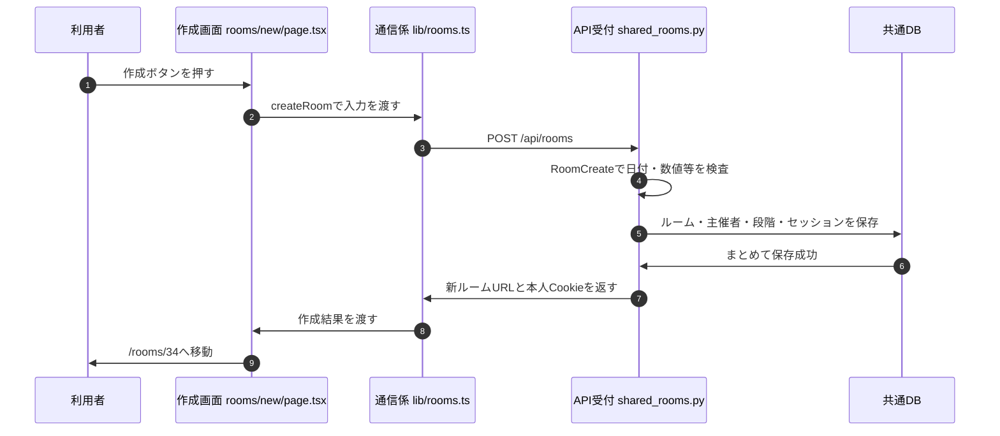

**なぜこの処理が必要か：** 画面だけでなくAPIも入力を検査し、不正な直接送信を防ぎます。ルームと主催者はまとめて保存し、途中だけ残る状態を防ぎます。

担当ファイル・処理：`frontend/app/rooms/new/page.tsx、frontend/lib/rooms.ts、backend/room_contract.py、backend/shared_rooms.py、backend/database.py`。

[図のSVG](図/シーケンス01.svg)／[編集用Mermaid](図/シーケンス01.mmd)

補足の実画面：保存後のルーム入口。

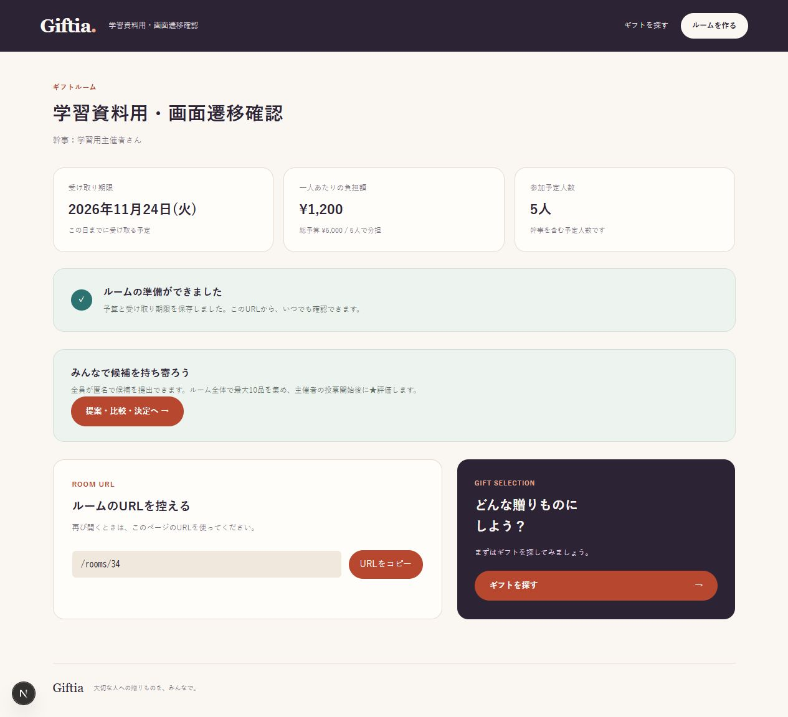

## 2. 入室して相手の情報を伝える

画面URL：`/rooms/34 → /rooms/34/select`。操作：「提案・比較・決定へ →」から入り「コメントして入室」を押す。

主催者はルーム作成時に参加登録済みなので、そのまま入室コメントへ進みました。好み／避けたいもの／その他を選び、情報がなければコメントせず入室できます。未参加者の名前フォームはコードで確認した分岐で、この画面写真は主催者のものです。

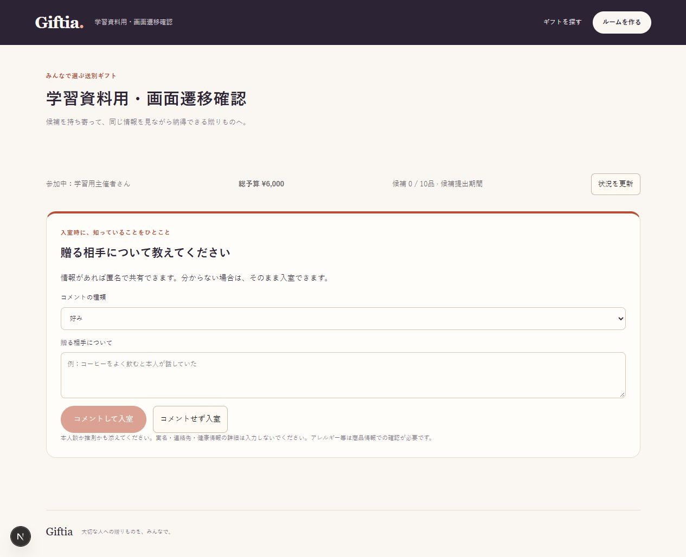

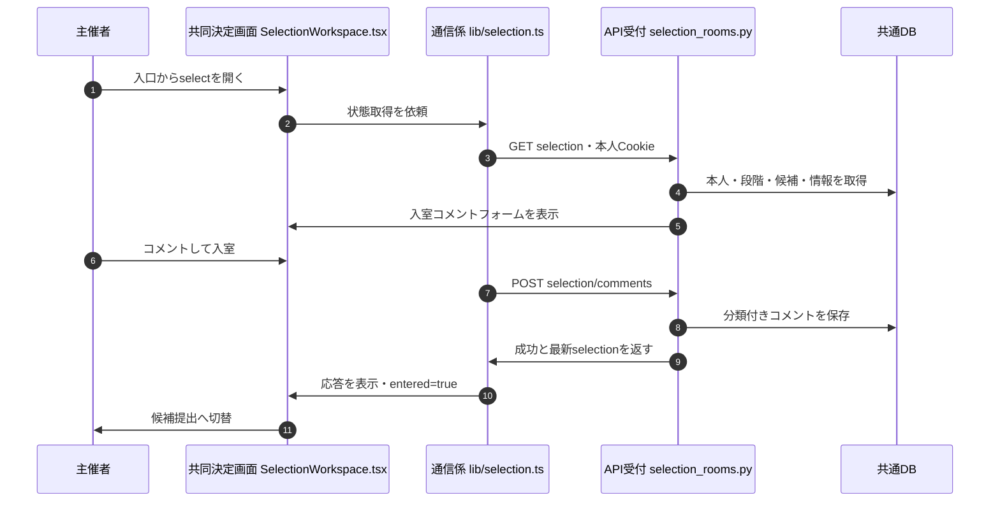

**なぜこの処理が必要か：** URLはルームの識別、Cookieは参加者の識別に使います。投稿したコメントはDBに残りますが、入室フォームを通過したかを示すenteredは画面内の変数です。

担当ファイル・処理：`frontend/app/rooms/[roomId]/page.tsx、select/page.tsx、select/SelectionWorkspace.tsx、frontend/lib/selection.ts、frontend/lib/localParticipation.ts、backend/shared_rooms.py`。

[図のSVG](図/シーケンス02.svg)／[編集用Mermaid](図/シーケンス02.mmd)

## 3. 商品を選び、下書きと提出を区別する

画面URL：`/rooms/34/select のまま`。操作：おまかせでカテゴリーを選び「候補に追加」→「この2品を提出する」。

今回の例では飲料を選ぶと最大3品が表示され、そこから2品を自分の候補へ追加しました。商品結果、自分の下書き、公開済み候補は別の情報です。候補への追加だけでは全員へ公開されません。

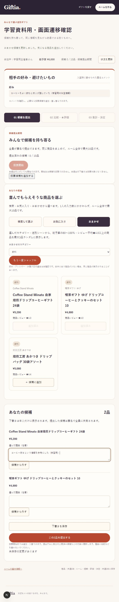

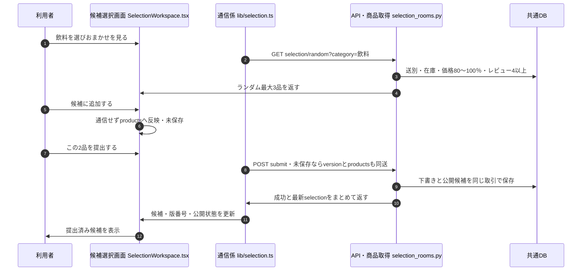

**なぜこの処理が必要か：** 下書きと公開は別の意味ですが、提出時は同じAPI依頼で一体保存できます。失敗した場合は下書きも取り消し、3回の通信を1回へ減らします。

担当ファイル・処理：`frontend/app/rooms/[roomId]/select/SelectionWorkspace.tsx、frontend/lib/selection.ts、backend/selection_rooms.pyのrandom_products・save_proposal・submit、backend/product_catalog.py`。

[図のSVG](図/シーケンス03.svg)／[編集用Mermaid](図/シーケンス03.mmd)

補足の実画面：提出後に公開された候補。

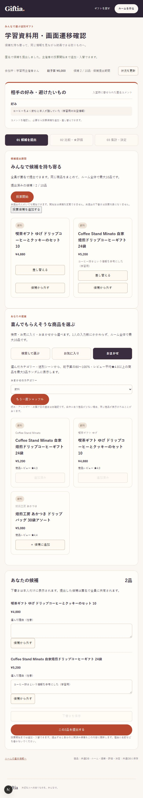

## 4. 投票を開始して星を付ける

画面URL：`/rooms/34/select のまま`。操作：主催者が「投票開始」、参加者が★1〜3を選ぶ。

主催者が開始した後に比較・評価の表示へ切り替わります。コメント入力も相手情報の一覧も投票中は表示しません。投票開始はDBの進行段階の変更で、タブを開くだけの操作とは異なります。

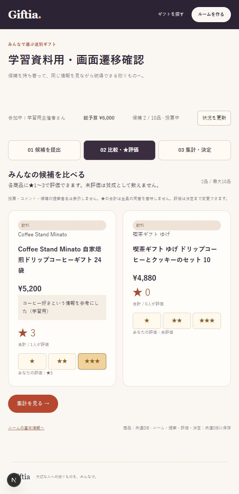

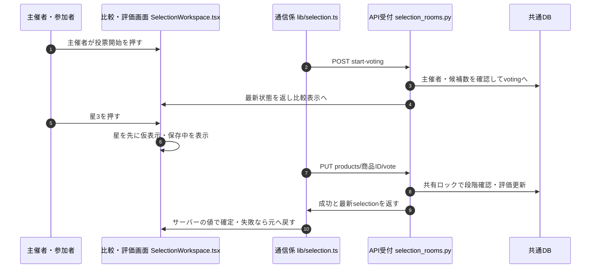

**なぜこの処理が必要か：** 星の表示はすぐ反映しますが、保存完了とは別です。API失敗時には元の評価に戻します。同時投票は共有ロック、決定・段階変更は排他ロックで整合を保ちます。

担当ファイル・処理：`frontend/app/rooms/[roomId]/select/SelectionWorkspace.tsx、frontend/lib/selection.ts、backend/selection_rooms.pyのstart_voting・vote、backend/selection_store.pyのsave_vote`。

[図のSVG](図/シーケンス04.svg)／[編集用Mermaid](図/シーケンス04.mmd)

## 5. 商品・贈り方・決定理由を選ぶ

画面URL：`/rooms/34/select のまま`。操作：「集計を見る →」→商品と理由を選択→「デモの購入確認へ」。

集計を見ること、商品や理由にチェックすること、デモ確認へ進むことは、この段階では画面内の操作です。まだ決定保存ではありません。「その他」を選んだ場合は説明文の入力も必要です。

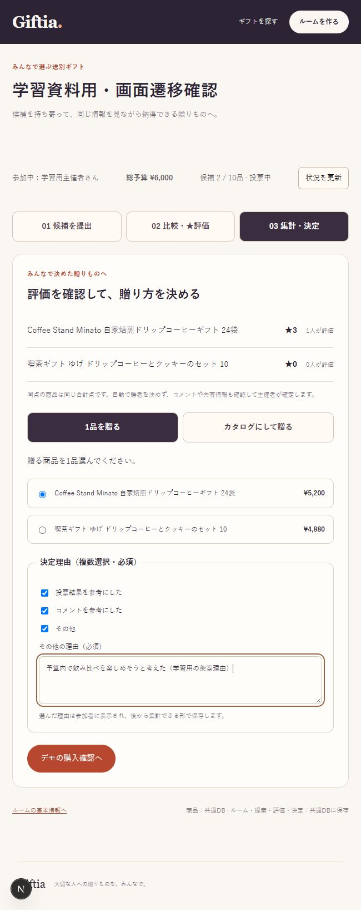

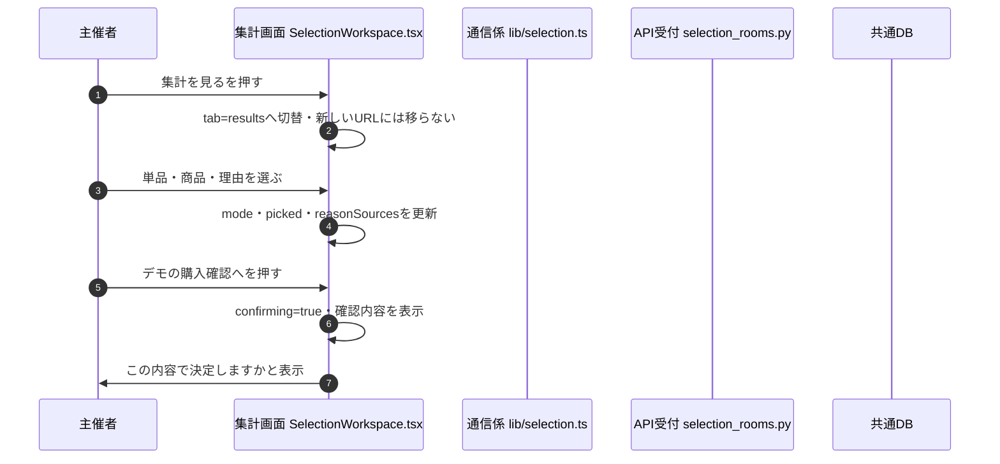

**なぜこの処理が必要か：** この図でAPIとDBに矢印がないのは、既に取得した候補を使って画面を切り替える操作だからです。画面の変化と保存を区別します。

担当ファイル・処理：`frontend/app/rooms/[roomId]/select/SelectionWorkspace.tsxのsetTab・mode・picked・reasonSources・confirming`。

[図のSVG](図/シーケンス05.svg)／[編集用Mermaid](図/シーケンス05.mmd)

補足の実画面：保存する前のデモ確認。

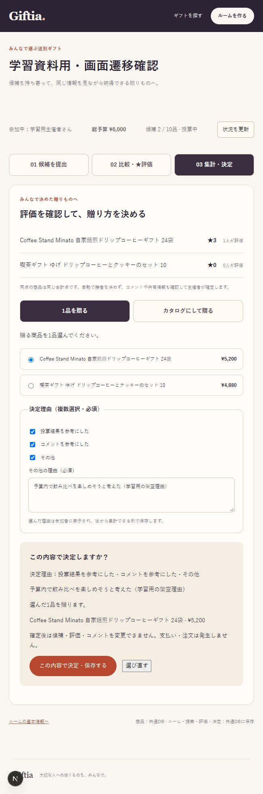

## 6. 決定を保存し、再訪して確認する

画面URL：`/rooms/34/select のまま・再訪も同じURL`。操作：「この内容で決定・保存する」→同じURLを再読込。

最後の保存ボタンで初めてAPIへ決定を送ります。主催者か、投票中か、候補の商品か、在庫・予算に問題がないかを確認して、商品と理由を保存します。その後に再訪しても決定を読み出せます。支払い・注文は発生しません。

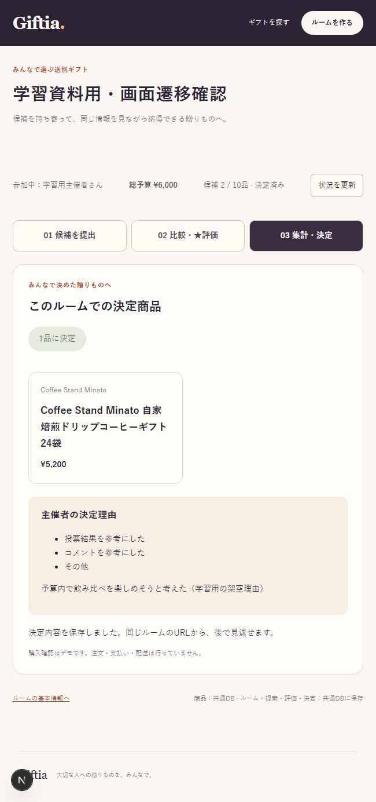

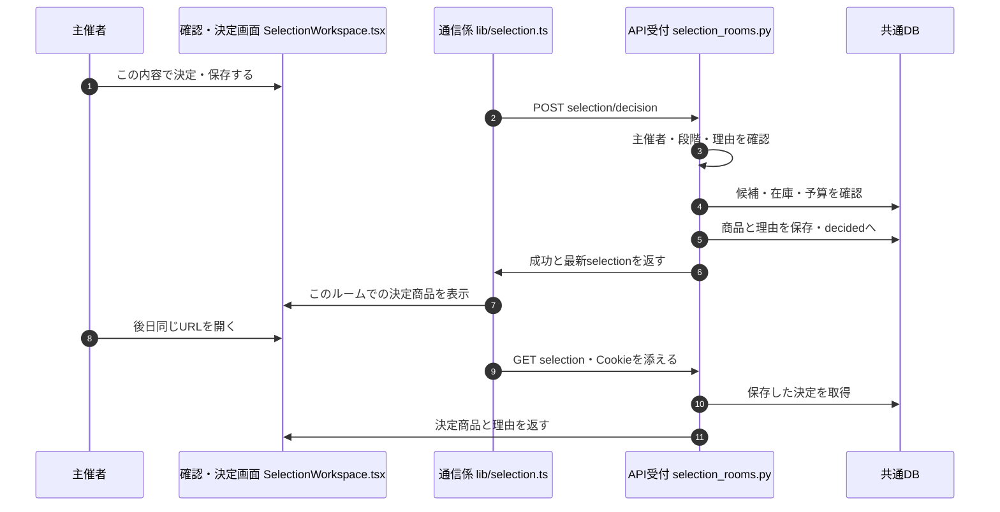

**なぜこの処理が必要か：** 決定は画面内変数でなくDBに残ります。ただし本人Cookieを失った場合の復元は別の残課題です。カタログを選ぶ別経路もコードにはありますが、この一連の画面確認は単品決定で実施しています。

担当ファイル・処理：`frontend/app/rooms/[roomId]/select/SelectionWorkspace.tsx、frontend/lib/selection.ts、backend/selection_rooms.pyのdecide・get_selection、selection_state.decision`。

[図のSVG](図/シーケンス06.svg)／[編集用Mermaid](図/シーケンス06.mmd)

## 役割を言葉にする練習

写真のボタンを1つ選び、「誰が押すか」「どの画面ファイルか」「APIへ送るか」「何を検査するか」「どこに保存するか」「次に何が表示されるか」を説明してください。集計タブとデモ確認のように、APIへ送らない操作も説明できると理解が深まります。

図の更新は画面やAPIが変わったときに行う。学習資料の作成でアプリコードは変更していない。
