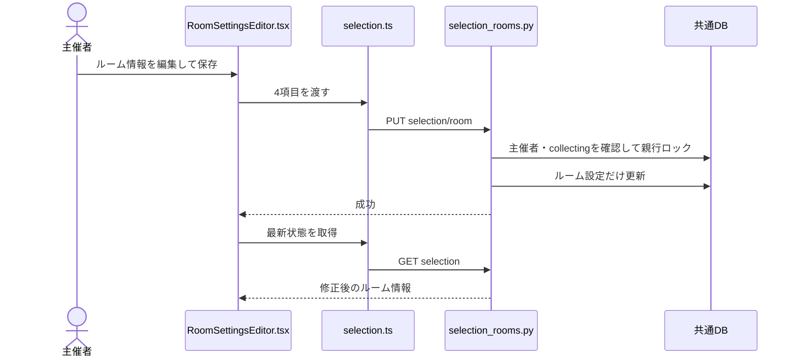
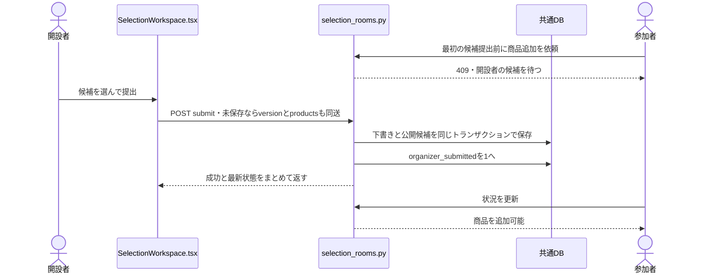

# 11/21追加：待ち時間・ルーム編集・開設者の初回提案

最新の正しい仕様はこの追補も含めて読む。ユーザーの実操作を受け、Issue #26で改善した。これ以前の写真は当時の確認記録で、新しい編集ボタン等が写っていないものもある。

## 利用者から見える変更

主催者は共同決定画面の「ルーム情報を編集」から、ルーム名・総予算・参加予定人数・受け取り期限を変更できる。投票開始前だけの操作で、候補やコメントを消して作り直す処理ではない。予算を下げても候補は残すので、価格の再確認が必要。最終決定時にも予算内かを確認する。

新しいルームは、開設者が1品以上を公開してから参加者も商品を追加できる。開設者が下書き保存しただけでは始まらない。参加者は待っている間も名前参加と入室コメントを先にできる。開設者の主催者調整による公開追加も最初の候補として扱う。

いったん開始すれば、主催者が元の候補を除外しても参加者の追加は閉じない。公開候補全体10品・匿名表示・手動の投票開始・★1〜3・決定理由は維持する。

既存ルームは参加可能なまま引き継ぐ。今回のルールは新しく開設するルームから適用し、過去の参加者を突然待機させない。

## 遅さに対して何を変えたか

後続の「各操作の快適性を優先したい」という依頼で、検索やおまかせの待機を保存処理の待機と分離した。検索中も表示済み商品を自分の候補へ追加できる。古い検索結果が新しい結果を上書きしないよう中止／応答番号を使う。下書きへの追加自体は通信しない。

星はクリック後すぐに仮表示し、「保存中」と表示してAPIの確定を待つ。保存失敗時は元へ戻す。表示が速いことと保存成功を混同させない。

| 従来 | 改善 | 初心者向けの意味 |
|---|---|---|
| APIがDB接続を毎回作り直す | 最大8本の接続を再利用し、利用後にトランザクションを取り消して返す。120秒で入れ替え | 毎回受付を最初から開き直す待ちを減らす。1本の接続を複数処理へ同時に渡すわけではない |
| 状態取得でも親行ロックと初期化書込 | 読み取りの取得では書込・FOR UPDATEをしない | 見ているだけの人が更新の順番待ちを増やさない。更新時のロックは維持 |
| 入室直後にカテゴリーも取得 | おまかせを開いたときだけ取得 | 使わない方法のための通信を後回しにする |
| 提出時に下書き保存・提出・再取得の3依頼 | 必要な下書きを提出APIへ同送し、最新状態も応答に含める | 利用者の「提出」1回に対して通信を1回にまとめる。途中の失敗では全体を取り消す |
| 未投票期間にも評価を集計、表ごとに個別取得 | MySQLの画面用情報はJSON集約で1回のSQLにまとめる | 同じデータをキャッシュでごまかすのではなく、DBとの細かな往復を減らす。本人・段階の確認は維持 |
| 追加・編集・入室コメント・投票開始・投票・決定の後にGET | 保存APIが最新selectionも返す | 成功後の再取得通信を省き、応答をそのまま画面へ反映 |
| 投票までルーム全体の排他ロック | 投票は共有ロック、候補変更・段階変更は排他ロック | 同時投票を互いに止めず、投票中に決定や段階変更が割り込むことは防ぐ |

読み取りの比較例：変更前は商品検索約2.19秒・ルーム取得約1.95秒。変更後、接続再利用時は商品検索約0.98秒、ルーム取得約0.76〜0.88秒。初回検索約2.5秒で、初回接続の待ちは残る。少数回・このPCと接続先での参考値で、すべての操作が1秒以内になる保証や正式な負荷試験ではない。

### 実画面での最終確認例

| 操作 | 確認した時間 | 何の時間か |
|---|---|---|
| 検索 | 約1.04秒 | クリックから検索商品の表示まで |
| 検索中の商品追加 | 約0.32秒 | 表示済み商品をクリックして自分の候補数が増えるまで。DB保存ではない |
| 3品提出 | 約3.55秒 | 送信から公開候補3品の表示まで |
| 投票開始 | 約2.51秒 | 送信から比較画面への切替まで |
| ★3を選ぶ | 約0.45秒 | 星の仮表示まで |
| 評価の保存完了 | 約2.34秒 | クリックから保存成功表示まで |
| 状況を更新 | 約1.29秒 | 接続再利用時の最新状態表示まで |
| 再読込から評価再表示 | 約3.46秒 | 再接続を含むページ表示の例 |

自動操作を含む1回ずつの参考値。比較途中の2品提出は約11.77秒（旧3回通信）→約5.67秒（通信統合のみ）。最終は3品・ビルド済み画面で条件も違うので、厳密な改善率は算出しない。画面の反応とサーバーの保存完了は別に測る。保存時のインターネット越しのDB往復や初回TLS接続は残る。さらに短縮する場合はAPIとDBの配置・ネットワーク遅延を計測して判断する。根拠なしにDBの地域やインフラを変更しない。

いまのローカル確認画面は、開発中のコンパイルを除いた`next build`＋`next start`。ソースを変更しても自動反映されないので、次の開発時はdevへ戻すか、停止→再ビルド→startが必要。

## どのファイルが担当するか

| ファイル | 新しい役割 |
|---|---|
| `frontend/app/rooms/[roomId]/select/RoomSettingsEditor.tsx` | 4項目の編集フォーム、日付検査、保存依頼 |
| 同フォルダの`SelectionWorkspace.tsx` | 待機／追加可能の表示、必要時のカテゴリー取得、提出応答で画面を更新 |
| `frontend/lib/selection.ts` | 新しいroom項目・initialProposalSubmittedの型 |
| `backend/room_contract.py` | 作成と編集で共通のRoomSettings入力検査 |
| `backend/selection_rooms.py` | 主催者・投票前の編集制限、初回提出判定、提出の一体処理と最新状態の応答 |
| `backend/connection_pool.py` | 接続の貸出・返却、上限・寿命、壊れた接続の破棄。保存データのキャッシュではない |
| `backend/shared_rooms.py`・`product_catalog.py` | 共通DB接続の再利用。参照だけのときは親行を書込ロックしない |
| `db/migrations/005_organizer_first.sql` | 初回提出状態の列を追加。既存行は1、新規作成はAPIから0で初期化 |
| `backend/manage_shared_storage.py` | apply-organizer-firstで005を既存列確認付きで適用 |

## シーケンス図：ルーム情報の修正



## シーケンス図：最初の候補と追加の開始



新APIは`PUT /api/rooms/{id}/selection/room`。提出APIは従来の本文なしにも対応し、未保存時はProposal本文を受け付ける。応答はokに加えてselectionを返す。古いversion、候補11品目、不正商品は拒否し、同送した下書きも取り消す。

## DB準備・確認範囲

002→003→004に続けて005を管理スクリプトで適用する。005は今回の共通DBに適用済み。再適用は既存列を確認し、削除しない。backendでWindowsは次のとおり。Macはpythonをpython3、パスを自分の既存設定へ置換する。

```powershell
python manage_shared_storage.py --env-file 'C:\path\to\existing\.env' apply-organizer-first
```

最終の通常テストは79件成功、実DB用25件は通常実行でskip。フロント既存13件、lint（警告なし）・型検査付きビルド成功。高速化後のMySQLでは各操作の最新状態応答、設定編集、提出一体処理の失敗時保持、同時3人投票の4件が成功。全25件を実DBで最終再実行した意味ではない。開設者先行等の追加3件もそれ以前の段階で確認済み。画面の記録は[操作改善後の画面](画面/11_操作改善と高速化.png)、詳細は[作業記録](../docs/work-log/2026-11-21-room-feedback.md)。

JSON集約はMySQLの[JSON生成関数](https://dev.mysql.com/doc/refman/8.0/en/json-creation-functions.html)と[集約関数](https://dev.mysql.com/doc/refman/8.0/en/aggregate-functions.html)を使用する。SQLite検証では同じ応答内容を従来の取得方法で構築する。

新機能を含む要求・要件の対応：BR-02・03・05、FR-01・02・17・18、DR-02、NFR-03。実決済・配送・全員同意確認・別端末本人復元は引き続き対象外。
